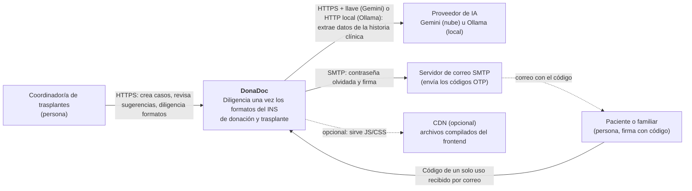
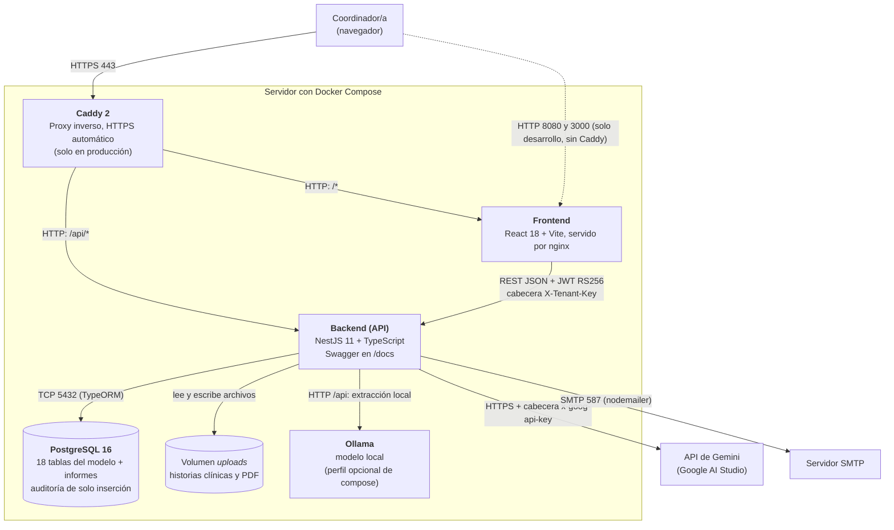

# Arquitectura de DonaDoc (modelo C4, niveles 1 y 2)

Este documento resume la arquitectura **implementada** con diagramas Mermaid (GitHub los dibuja solo).
Este documento describe el sistema completo (repositorios `donadoc-backend` y `donadoc-frontend`).
Los diagramas se generaron con ayuda de IA a partir del árbol del proyecto, los `package.json`, el `docker-compose.yml`
y el código, y **se contrastaron con el código**; las correcciones hechas están al final.

## Nivel 1: contexto

¿Quién usa DonaDoc y con qué sistemas externos habla?

Notas:

- El proveedor de IA es **uno solo a la vez**, elegido por configuración (`EXTRACTOR_IA_PROVIDER`: `gemini`, `ollama` o `mock`).
- Con Gemini (externo) los identificadores del paciente se enmascaran antes de enviar el texto.
- El firmante no entra a una cuenta: confirma con un código que recibe por correo.
- El CDN es opcional (`VITE_ASSET_BASE` / `CDN_ORIGIN`); por defecto todo se sirve del mismo origen.

## Nivel 2: contenedores

Las piezas que se despliegan y cómo se comunican (tecnología y protocolo en cada flecha).

Contenedores y responsabilidades:

| Contenedor | Tecnología | Qué hace | Dónde está |
|---|---|---|---|
| Frontend | React 18, Vite, Zustand, React Hook Form + Zod, Axios | Interfaz; solo renderiza, la lógica va en hooks y el HTTP en `apis/` | repositorio `donadoc-frontend` |
| Backend | NestJS 11, TypeORM, JWT RS256, Swagger | API REST: casos, documentos, extracción con IA, formatos, firma con OTP, red, auditoría | este repositorio |
| Base de datos | PostgreSQL 16 | Datos del negocio; esquema por migraciones al desplegar | `Backend/src/database/migrations` |
| Archivos | Volumen Docker | Historias clínicas cargadas y PDF generados (detrás de la abstracción `almacenamiento`) | `Backend/src/documentos/storage` |
| Proxy | Caddy 2 | HTTPS, redirige `/api/*` al backend y el resto al frontend | `deploy/Caddyfile` |
| IA local | Ollama | Alternativa gratuita a Gemini; solo con `--profile ollama` | `docker-compose.yml` |

Despliegue: GitHub Actions ejecuta las pruebas ([`ci.yml`](../.github/workflows/ci.yml)), publica las imágenes en GHCR y
despliega por SSH ([`deploy.yml`](../.github/workflows/deploy.yml)). Detalle en [`DESPLIEGUE.md`](DESPLIEGUE.md).

## Verificación contra el código

Regla de la sesión: no dibujar componentes que no existan. Esto se comprobó en el repositorio:

| Componente que podría suponerse | Qué hay en el código | Decisión en el diagrama |
|---|---|---|
| Cola de mensajes (Redis, RabbitMQ) | Ninguna dependencia de colas en `package.json`; si la IA falla, la extracción queda pendiente en la base de datos | No se dibuja |
| Servicio de autenticación separado | Es el módulo `auth/` dentro del backend | Un solo contenedor de backend |
| Almacenamiento S3 | Disco local en el volumen `uploads` (`almacenamiento-local.ts`), tras la abstracción `almacenamiento` | Se dibuja el volumen |
| Gemini y Ollama a la vez | Un solo proveedor según `EXTRACTOR_IA_PROVIDER` | Aclarado en las notas del nivel 1 |
| Caddy en desarrollo | Solo existe en `deploy/docker-compose.prod.yml`; `docker-compose.yml` expone 8080 y 3000 | Flecha punteada de desarrollo |

> **Corrección para explicar en clase (completar por quien presenta):** escriba aquí la corrección concreta que hizo al
> comparar el diagrama generado por su IA con el código.

## Decisiones de arquitectura (ADR)

- [ADR-001: NestJS con TypeScript y React como stack](adr/ADR-001-stack-nestjs-react.md)
- [ADR-002: PostgreSQL como base de datos](adr/ADR-002-postgresql.md)
