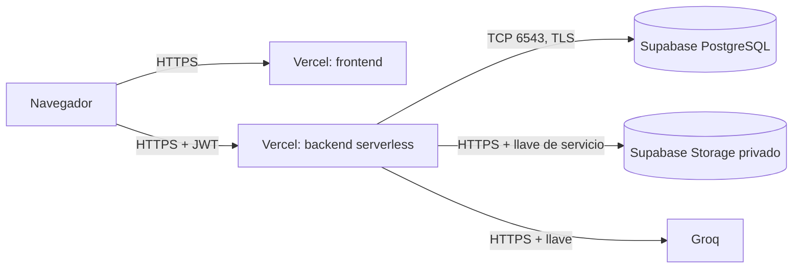

# Manual de despliegue (Vercel + Supabase)

DonaDoc se despliega con servicios de capa gratuita:

| Pieza | Servicio | Qué guarda |
|---|---|---|
| Frontend (`donadoc-frontend`) | Vercel (proyecto 1) | Archivos estáticos de la interfaz |
| Backend (`donadoc-backend`) | Vercel (proyecto 2), como función serverless | La API NestJS (`api/index.js` → `dist/serverless.js`) |
| Base de datos | Supabase (PostgreSQL) | Todas las tablas |
| Archivos | Supabase Storage (bucket **privado** `documentos`) | Historias clínicas y PDF generados |
| IA | Groq (llave gratuita) | Solo recibe texto con identificadores enmascarados |



> Ninguna llave ni clave está en el repositorio: se generan en su equipo y se pegan en las variables de entorno de Vercel.

## 1. Generar los secretos (en su equipo)

```bash
node scripts/generar-secretos.mjs
```

Crea `.env.secretos` (Git lo ignora) con `JWT_PRIVATE_KEY`, `JWT_PUBLIC_KEY`, `DATA_ENCRYPTION_KEY`, `OTP_PEPPER` y `SEED_ADMIN_PASSWORD`.
Guarde una copia segura de `DATA_ENCRYPTION_KEY`: si se pierde, los datos cifrados no se pueden recuperar.

## 2. Supabase

1. Cree un proyecto en <https://supabase.com> y guarde la contraseña de la base de datos.
2. **Storage → New bucket**: nombre `documentos`, **sin** marcarlo como público.
3. **Project Settings → API**: copie la *Project URL* y la llave `service_role` (secreta; solo va al servidor).
4. **Connect → Connection pooling**: copie el host del *pooler* (`aws-…pooler.supabase.com`) y el usuario `postgres.<id-del-proyecto>`.
   - *Session pooler* (puerto 5432): para migrar desde su equipo.
   - *Transaction pooler* (puerto 6543): para Vercel.

## 3. Crear las tablas y el usuario demo (una sola vez, desde su equipo)

Cree un archivo `.env` (Git lo ignora) con las variables de `.env.example` y estos valores: `ENVIRONMENT=local`, `DB_HOST`, `DB_PORT=5432`, `DB_USER`,
`DB_PASSWORD`, `DB_NAME=postgres`, `DB_SSL=true`, `SEED_ENABLED=true`, `EXTRACTOR_IA_PROVIDER=mock`, y los cinco secretos del paso 1.

```bash
npm ci
npm run build
node dist/main.js     # aplica las migraciones y crea el usuario demo; deténgalo con Ctrl+C cuando diga que escucha
```

Use **la misma** `DATA_ENCRYPTION_KEY` que pondrá en Vercel. El usuario demo es `coordinador@demo.local` y su clave es `SEED_ADMIN_PASSWORD`.

## 4. Backend en Vercel

1. Vercel → *Add New Project* → importe `donadoc-backend` (rama `main`). El framework se detecta como *Other*; `vercel.json` ya define la compilación.
2. Variables de entorno (valores en blanco aquí a propósito):

| Variable | Valor |
|---|---|
| `ENVIRONMENT` | `dev` (con `prod` se exige SMTP real; ver límites) |
| `DB_HOST`, `DB_USER`, `DB_PASSWORD`, `DB_NAME` | los del *transaction pooler* de Supabase |
| `DB_PORT` | `6543` |
| `DB_SSL` | `true` |
| `DB_POOL_MAX` | `3` |
| `JWT_PRIVATE_KEY`, `JWT_PUBLIC_KEY`, `DATA_ENCRYPTION_KEY`, `OTP_PEPPER` | de `.env.secretos` |
| `STORAGE_PROVIDER` | `supabase` |
| `SUPABASE_URL`, `SUPABASE_SERVICE_KEY` | de Supabase → Settings → API |
| `SUPABASE_BUCKET` | `documentos` |
| `EXTRACTOR_IA_PROVIDER` | `groq` |
| `GROQ_API_KEY` | su llave de <https://console.groq.com/keys> |
| `MAX_UPLOAD_MB` | `4` (Vercel limita el cuerpo de una solicitud a 4,5 MB) |
| `FRONTEND_URL` | la URL del frontend en Vercel (para CORS) |
| `MAIL_PROVIDER` | `consola` (los códigos OTP quedan en los logs de Vercel) |

3. *Deploy*. Compruebe `https://<backend>.vercel.app/health` y `/health/ready` (debe responder `ok`).

## 5. Frontend en Vercel

1. *Add New Project* → importe `donadoc-frontend`. `vercel.json` ya define la compilación y el enrutado de la SPA.
2. Variables: `VITE_API_BASE_URL` = `https://<backend>.vercel.app/api/v1` y `VITE_TENANT_KEY` = la clave pública de la organización (`pk_demo_clinica` si usó el usuario demo).
3. *Deploy*. Después, vuelva al backend y ponga la URL real del frontend en `FRONTEND_URL`.

## 6. Verificación

1. Abra la URL del frontend e inicie sesión con el usuario demo.
2. Cree un caso, cargue `docs/ejemplos/historia_clinica_sintetica.txt` y pida la extracción: deben aparecer sugerencias con su confianza (Groq).
3. Revise en Supabase → Storage que el archivo quedó en el bucket y en Table Editor que los datos clínicos aparecen **cifrados**.

## Límites conocidos de este despliegue

- **Arranque en frío:** la primera solicitud tras un rato sin uso puede tardar unos segundos.
- **Archivos de hasta ~4 MB** por el límite de Vercel; el límite configurable (`MAX_UPLOAD_MB`) es 5 MB en otros entornos.
- **Correo OTP:** con `MAIL_PROVIDER=consola` el código de la firma y del restablecimiento de clave se lee en los logs de Vercel. Con un SMTP real (issue #16) se puede usar `ENVIRONMENT=prod`.
- **Límite de solicitudes por IP** en memoria: cada instancia serverless lleva su propia cuenta.
- **IA externa:** los identificadores se enmascaran antes de enviar el texto, pero el texto clínico sale a Groq; use datos sintéticos.
- **Swagger** queda disponible en `/docs` mientras `ENVIRONMENT=dev`.
- No se probó aún con carga real; las pruebas de rendimiento corren contra un servidor normal en el CI, no contra Vercel.
