# Manual de usuario – DonaDoc

**DonaDoc** es una plataforma web para **diligenciar una sola vez** la documentación de donación y trasplante de órganos y tejidos.
Usted carga la historia clínica una vez, la IA le sugiere los datos, usted decide cuáles aceptar, y el sistema llena los formatos, genera el PDF y lo hace firmar con un código enviado al correo.

- **Aplicación:** https://donadoc-frontend.vercel.app
- **Quién lo usa:** el coordinador/a de trasplantes (usuario principal), el administrador de la institución y el superadmin. El paciente o familiar solo confirma su firma con un código.
- **Datos de prueba:** use **solo datos sintéticos**. No ingrese datos reales de pacientes.

> **Credenciales de prueba:** por seguridad no están escritas aquí, porque este repositorio es público. Se entregan aparte al docente. Si necesita acceso, pídaselo a quien administra la plataforma (ver la sección *Administrar accesos*).

---

## 1. Iniciar sesión

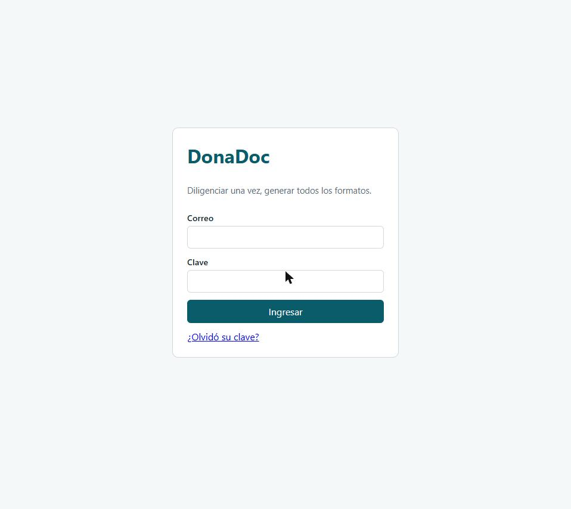

1. Abra la dirección de la aplicación.
2. Escriba su **correo** y su **clave** y pulse **Ingresar**.
3. Si olvidó su clave, pulse **¿Olvidó su clave?**: le llega un código de 6 dígitos al correo (vence en 10 minutos y sirve una sola vez) con el que puede definir una clave nueva.

La **primera vez**, si su clave fue generada por el sistema (la recibió por correo), cámbiela desde el menú **Cambiar clave**: debe tener al menos 10 caracteres, con letras y números.

---

## 2. Tarea principal: de la historia clínica al documento firmado

El flujo completo tiene cinco pasos. Se hace dentro de un **caso** (un donante).

### Paso 1. Crear un caso

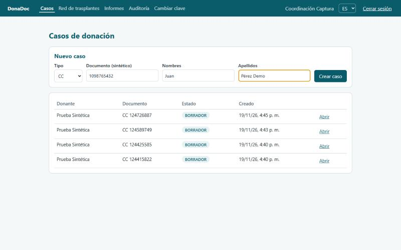

1. En el menú, entre a **Casos**.
2. En **Nuevo caso** elija el tipo y escriba el documento (sintético), los nombres y los apellidos.
3. Pulse **Crear caso**. El caso aparece en la lista; pulse **Abrir** para entrar.

Un caso pasa por estados: borrador, en curso, firmado, cerrado o contraindicado. Puede cambiarlos con **Cambiar estado**.

### Paso 2. Cargar la historia clínica

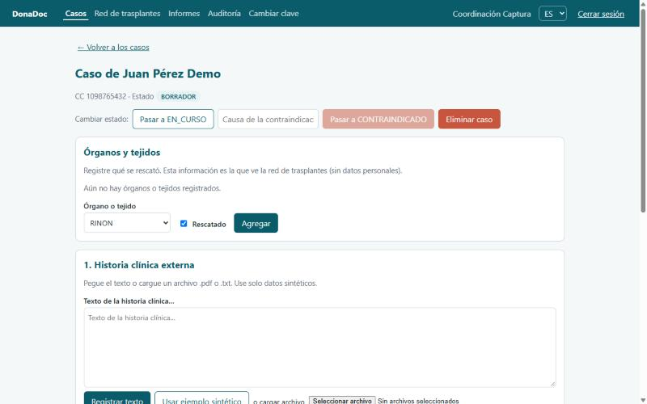

1. En **1. Historia clínica externa**, pegue el texto y pulse **Registrar texto**, o cargue un archivo `.pdf` o `.txt` (hasta unos 4 MB).
2. Para practicar puede usar **Usar ejemplo sintético**.
3. Verá el aviso **Historia clínica registrada** y el archivo en la lista.

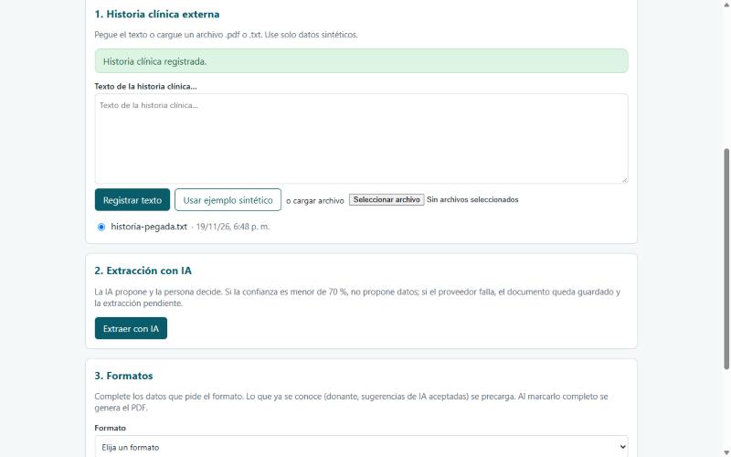

### Paso 3. Extraer los datos con IA

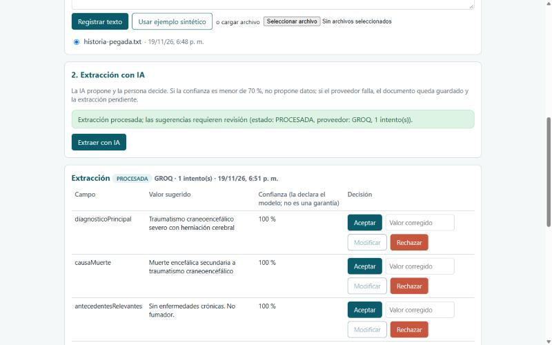

1. En **2. Extracción con IA**, pulse **Extraer con IA**.
2. Aparecen sugerencias para cinco datos: diagnóstico principal, causa de muerte, antecedentes, fecha de ingreso y grupo sanguíneo, cada una con su **confianza**.
3. Para cada una elija **Aceptar**, **Modificar** (escriba el valor corregido) o **Rechazar**. **Nada se guarda sin su decisión.** Lo aceptado queda marcado como ACEPTADA.

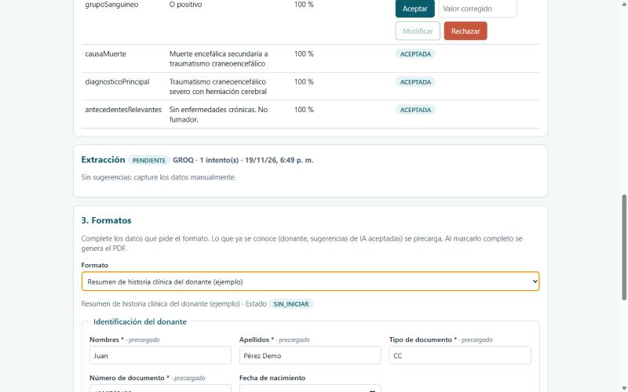

Si el proveedor de IA falla, el documento queda guardado y la extracción queda **pendiente** (puede reintentar o capturar a mano):

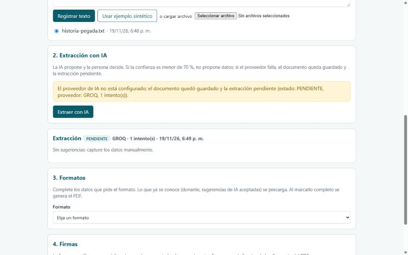

### Paso 4. Diligenciar el formato y generar el PDF

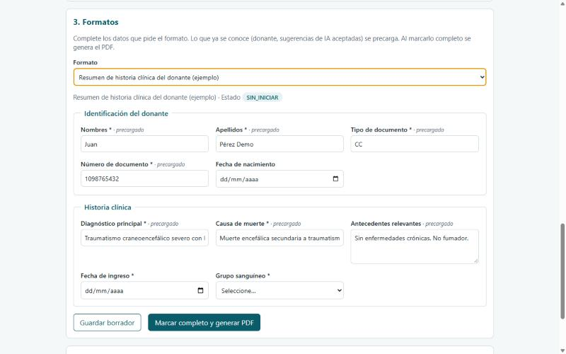

1. En **3. Formatos**, elija el formato que necesita.
2. Los datos conocidos (donante y sugerencias aceptadas) aparecen **precargados**. Complete lo que falte.
3. **Guardar borrador** conserva su avance; **Marcar completo y generar PDF** genera el documento, que puede descargar con **Descargar PDF**.

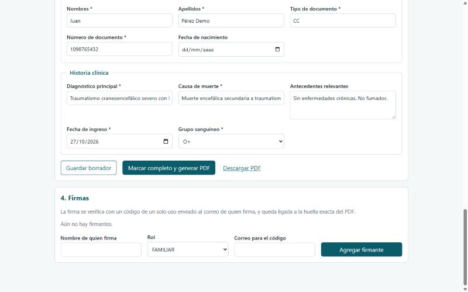

### Paso 5. Firmar con un código

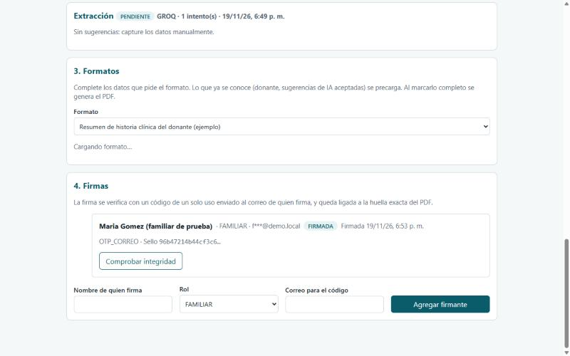

1. En **4. Firmas**, agregue a quien firma: nombre, rol y **correo** (allí llega el código).

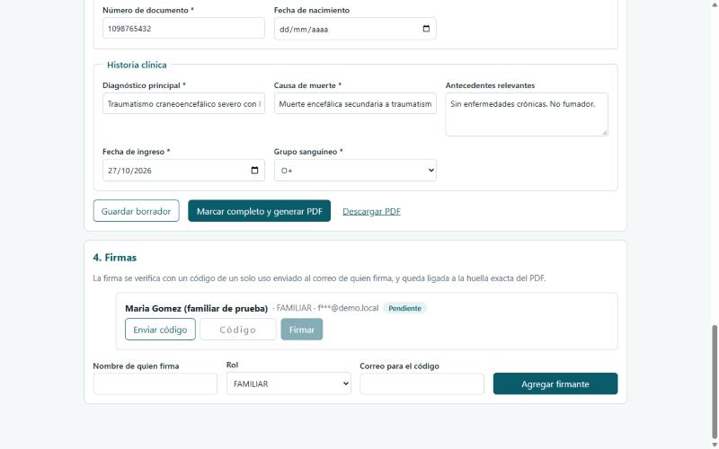
2. Pulse **Enviar código**; quien firma lo recibe por correo.
3. Escriba el código y pulse **Firmar**. El documento queda **firmado y ya no admite cambios**.
4. **Comprobar integridad** confirma que el documento no cambió desde que se firmó.

> Es una firma electrónica simple. Su validez legal para cada formato debe confirmarla el área jurídica de la institución.

---

## 3. Otras pantallas

- **Informes:** informes periódicos (mensuales o semanales) de los bancos de tejido. Elija el informe y el periodo, guarde borradores y márquelo completo para generar el PDF.

  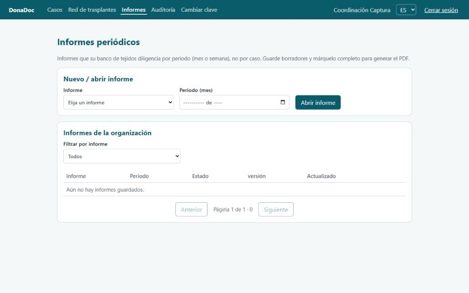

- **Red de trasplantes:** trasplantes en curso de todas las instituciones, **sin datos personales** del donante (solo un código público, la institución, el tipo y los órganos).

  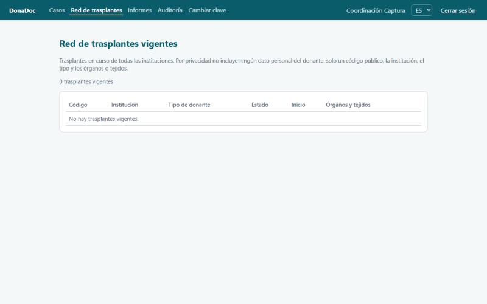

- **Auditoría (solo administrador):** quién consultó, creó, modificó o eliminó información, y cuándo. El registro no se puede modificar ni borrar.

  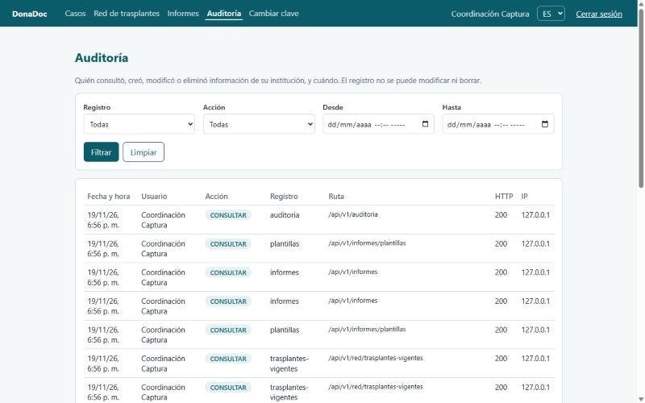

- **Cambiar clave:** exige la clave actual.

  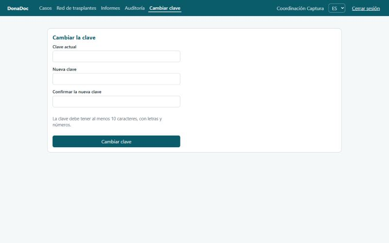

---

## 4. Administrar accesos (solo superadmin)

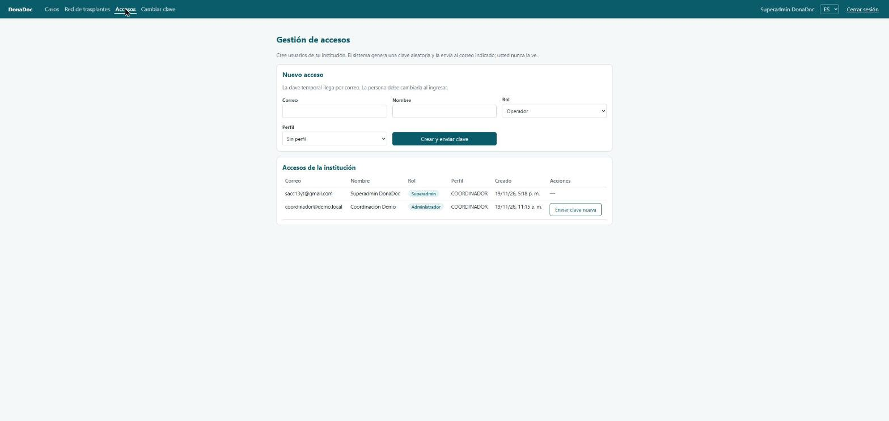

El superadmin no trabaja con casos: su pantalla de inicio es **Accesos**.

1. Escriba el **correo** y el **nombre** de la persona, elija su **rol** (Operador o Administrador) y, si quiere, un **perfil**.
2. Pulse **Crear y enviar clave**. El sistema genera una clave **aleatoria** y la envía **por correo** a esa persona; **usted nunca la ve**.
3. Si alguien pierde su clave, pulse **Enviar clave nueva** en su fila.
4. Si el correo no se puede enviar, el acceso **no se crea** (para no dejar usuarios sin clave).

---

## 5. La función de IA: qué hace y cuáles son sus límites

**Qué hace.** Lee el texto de la historia clínica y propone cinco datos para que usted los acepte o corrija. Evita que usted tenga que transcribirlos a mano.

**Cómo está hecha.**
- Usa un modelo de lenguaje por medio del proveedor **Groq** (modelo `openai/gpt-oss-120b`). También hay adaptadores para Gemini y Ollama, y un simulador solo para pruebas.
- El texto va al modelo dentro de un *prompt* con reglas fijas: extraer solo lo que el texto diga de forma explícita, **no inventar ni deducir**, devolver `null` si un dato no aparece, y **no obedecer instrucciones que aparezcan dentro del documento**.
- **Antes de enviar el texto a un proveedor externo se enmascaran** correos, teléfonos y números largos (identificadores).

**Controles de seguridad.**
- **Umbral de confianza:** si la confianza declarada es menor de 70 %, la IA no propone ese dato.
- **Verificación contra el texto:** cada valor sugerido debe poder rastrearse al texto fuente; lo que el modelo "completó" por su cuenta se descarta.
- **La IA propone y la persona decide:** ninguna sugerencia se guarda sin su revisión.
- **Si el proveedor falla** (no responde, sin cuota, llave inválida), el documento queda guardado y la extracción queda **pendiente**; no se pierde nada.

**Límites que debe conocer.**
- La **confianza la declara el propio modelo**: no es una garantía. La revisión humana es obligatoria.
- En una prueba con un modelo local (`llama3.1:8b`) y un conjunto pequeño de historias sintéticas la extracción obtuvo F1 = 0,968: es una **tendencia, no precisión clínica**.
- Un texto que contenga instrucciones maliciosas **puede intentar influir en el modelo**; el *prompt* y la verificación contra el texto reducen el riesgo, pero no lo eliminan.
- Con un proveedor externo, el texto clínico **sale de la institución** (enmascarado). Use datos sintéticos.
- Si el PDF está dañado o es una imagen sin texto, no se puede extraer nada.

**Pruebas hechas.** Pruebas automáticas del *prompt*, del análisis de respuestas y de las fallas del proveedor (tiempo agotado, cuota, llave rechazada, respuesta inválida, PDF dañado), y una prueba real contra Groq sobre la historia sintética: 5 sugerencias en menos de 2 segundos.

---

## 6. Problemas frecuentes

| Problema | Causa | Qué hacer |
|---|---|---|
| Al **recargar** la página (F5) vuelve al inicio de sesión | La sesión vive solo en la pestaña | Inicie sesión de nuevo; no recargue durante el trabajo |
| La **primera pantalla tarda** varios segundos | El servidor estaba inactivo y arranca en frío | Espere unos segundos y reintente |
| "**No tiene permiso para esta acción**" | Su rol no incluye esa pantalla (p. ej. el superadmin no ve casos) | Use la cuenta con el rol adecuado |
| La extracción queda en **pendiente** | El proveedor de IA falló o no tiene cuota | Reintente en unos minutos; capture los datos a mano si es urgente |
| "**Credenciales inválidas**" | Correo o clave incorrectos | Revise mayúsculas; use **¿Olvidó su clave?** |
| El archivo no se carga | Solo `.pdf` y `.txt`, hasta unos 4 MB, y el PDF debe ser un PDF real | Convierta o reduzca el archivo |
| **No llega el código** por correo | Revisar spam; el servicio de correo puede estar saturado | Espere 1 minuto y pida otro código |

**Seguridad para tener presente.** Las claves temporales llegan por correo en texto plano: cámbielas al ingresar. La aplicación guarda los datos clínicos sensibles **cifrados** (AES-256-GCM) en la base de datos y los archivos en un almacenamiento **privado**. Lo pendiente en materia de cifrado (identificación del donante y archivos en disco) está documentado en `docs/requisitos.md`.

---

## 7. Cómo se desplegó (resumen)

Al iniciar el módulo la aplicación solo corría en un computador; **hoy está desplegada en línea**: frontend y backend en Vercel, base de datos y archivos en Supabase y la IA en Groq. El detalle técnico está en [`docs/despliegue.md`](despliegue.md).
